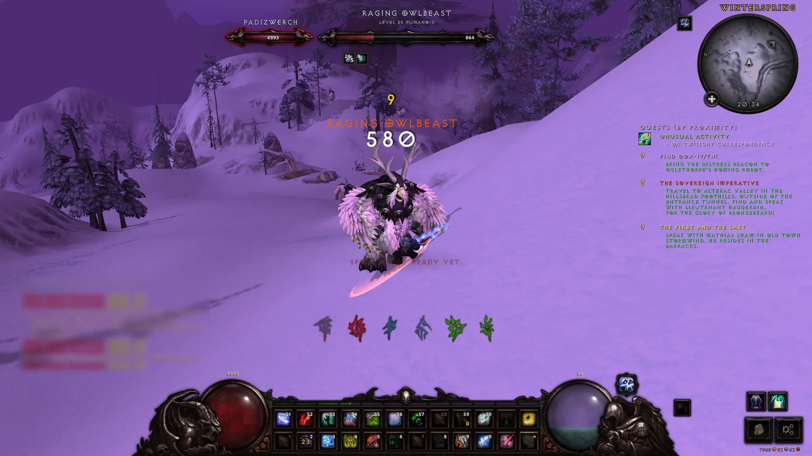
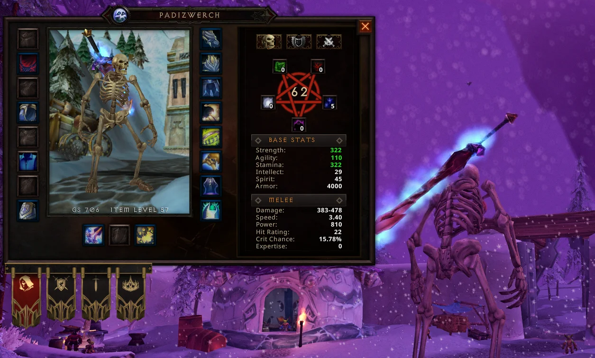

= DiabolicUI for Wotlk 3.3.5

// coverage:begin
// Generated by tests/coverage/run.sh --readme. Don't edit by hand.
image:https://img.shields.io/badge/coverage-100.0%25-brightgreen["Line coverage 100.0% on 2026-11-11",height=20]
// coverage:end

A full Diablo III-style UI for the WoW 3.3.5a client: Goldpaw's DiabolicUI, forked and extended for 3.3.5.

== 🚀 Install

. Download the zip from https://github.com/apt-get-update/DiabolicUI/releases/latest[the latest release].
. Unzip it into `Interface/AddOns/`.
. In game: `/dui config` for the options, `/dui move` to move frames.

What's new in each version: https://github.com/apt-get-update/DiabolicUI/releases[releases].

== ✨ Features

* *Diablo III style*: health and mana orbs, restyled windows, loot and roll windows; optional GShade for a darker look (see below).
* *All in one*: specializations in one click (talents, gear, bars, macros), GearScore, movable frames, shorter chat.
* *Options*: intuitive and easy to tweak.
* *In combat*: incoming heals on the orbs, gold, XP and loot gained shown at the right.

[cols="2*a",frame=none,grid=none]
|===
|image::docs/screenshots/quest-log.webp[Quest log]
|image::docs/screenshots/spellbook.webp[Spellbook, unassigned spells lit]
|image::docs/screenshots/talents.webp[Talents]
|image::docs/screenshots/reputation.webp[Reputation]
|image::docs/screenshots/options.webp[Options (/dui config)]
|image::docs/screenshots/options-positions.webp[Positions page]
|image::docs/screenshots/specialization.webp[Specializations page]
|image::docs/screenshots/talent-skull.webp[Specialization button]
|image::docs/screenshots/raid.webp[Raid frames by group]
|image::docs/screenshots/party.webp[Party frames]
|image::docs/screenshots/move-mode.webp[Unlock Frames (/dui move)]
|image::docs/screenshots/roll-window.webp[Roll window]
|===

[cols="3*a",frame=none,grid=none]
|===
|image::docs/screenshots/loot.webp[Loot window]
|image::docs/screenshots/loot-preview.webp[Loot preview]
|image::docs/screenshots/gains.webp[Gold and loot gained]
|image::docs/screenshots/tooltip.webp[Item tooltip]
|image::docs/screenshots/spell-tooltip.webp[Spell tooltip]
|image::docs/screenshots/spec-button-tooltip.webp[Specialization button tooltip]
|image::docs/screenshots/reputation-hover.webp[Reputation bar tooltip]
|image::docs/screenshots/chat-loot.webp[Shorter loot messages]
|
|===

== 🧩 Recommended addons

https://github.com/sloan-008/Questie-335[Questie],
https://github.com/paokkerkir/Mapster[Mapster],
https://github.com/NoM0Re/WoW-3.3.5a-Addons#action-bar-saver-2[Action Bar Saver],
https://github.com/thierbig/TrinketMenu-3.3.5[TrinketMenu],
https://github.com/bkader/Masque-WoTLK[Masque] with https://www.curseforge.com/wow/addons/masque-diabolic[Masque_Diabolic],
https://github.com/Stormhand-dev/Lexara---HD-Font-Renderer-for-WoW-3.3.5[Lexara].

== 🎨 Optional: GShade

A darker Diablo look, the UI left sharp. See link:extras/gshade/README.adoc[extras/gshade].

== 🛠️ Development

Developer docs: https://apt-get-update.github.io/DiabolicUI/[apt-get-update.github.io/DiabolicUI]. Tests run offline (`tests/run_all.sh`), see `tests/README.md`.

== 📜 Credits

Lars "Goldpaw" Norberg (DiabolicUI, DiabolicUI2, the minimap, ChatCleaner), https://github.com/Hrishi29x/DiabolicUI[Hrishi29x] (the first 3.3.5 fork), GearScoreLite, Kui_Nameplates, Masque_Diabolic, and Blizzard Entertainment (Diablo III's art and the Exocet font). Thanks to MinimapButtonBag (karlsnyder), whose job the minimap's "+" now does. Questie, TrinketMenu, Immersion, AdiBags and BiS-Tooltip Renewed are restyled or read from; their code stays theirs. GShade credits: link:extras/gshade/README.adoc[its README].
