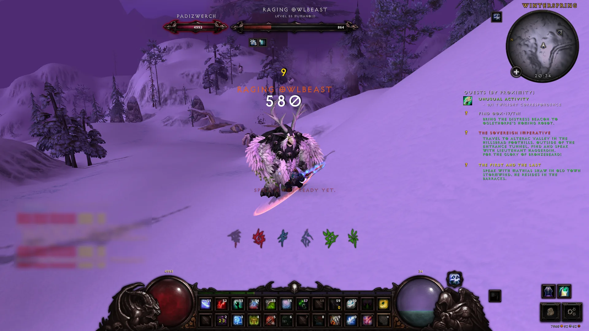
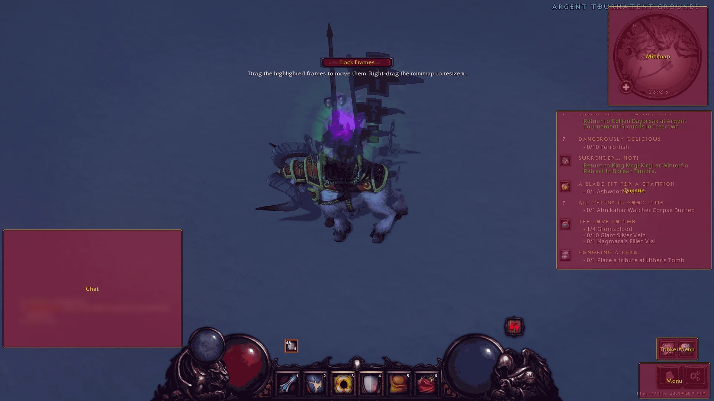

= DiabolicUI for Wotlk 3.3.5

Forked from https://github.com/Hrishi29x/DiabolicUI

Well met, traveler. I am but a humble tinkerer who took DiabolicUI, forked it for 3.3.5, and mended what small things I could along my travels through Northrend. Nothing grand, just a few fixes and features gathered on the road and shared freely, should they serve you as well as they have served me. The full list lies below.

== 🧩 Recommended Addons

[cols="1,3",options="header"]
|===
|Addon |What for
|https://github.com/sloan-008/Questie-335[Questie] |📜 quests, quest log and tracker
|https://github.com/paokkerkir/Mapster[Mapster] |🗺️ world map
|https://github.com/bkader/KuiNameplates-WoTLK[Kui_Nameplates] |🏷️ nameplates
|https://github.com/NoM0Re/WoW-3.3.5a-Addons#action-bar-saver-2[Action Bar Saver] |💾 action bar profiles, one per specialization
|https://github.com/thierbig/TrinketMenu-3.3.5[TrinketMenu] |💍 trinket switching, styled by DiabolicUI
|https://www.curseforge.com/wow/addons/mbb/files/all?page=1&pageSize=20&version=3.3.5&showAlphaFiles=hide[MBB] |🎒 minimap buttons in one bag
|https://github.com/bkader/Masque-WoTLK[Masque] + https://www.curseforge.com/wow/addons/masque-diabolic[Masque_Diabolic] |🔘 Diablo buttons for other addons (Bagnon...)
|https://github.com/bkader/SharedMedia[SharedMedia] + https://github.com/GoldpawsStuff/SharedMedia_ExocetBlizzard[SharedMedia_ExocetBlizzard] |🔤 the Diablo font in other addons
|https://github.com/Stormhand-dev/Lexara---HD-Font-Renderer-for-WoW-3.3.5[Lexara] |🔍 sharper fonts
|===

== 🚀 Getting Started

Drop the `DiabolicUI` folder in `Interface/AddOns/`. Everything is set in `/dui config`.

* `/dui num_bars 1-3` and `/dui num_side_bars 0-2`: how many action bars.
* `/dui move`: move the minimap, the chat, the menu buttons, the quest tracker (Blizzard's or Questie's) and TrinketMenu; right-drag the minimap to resize it. Also the *Unlock Frames* button in `/dui config`.

== ✨ Features

* ⚔️ *Action bars* between Diablo III health and mana orbs, one to three rows plus side bars.
* 💀 *Specialization button* on the skull: switches spec, and each spec can bring its gear set, Action Bar Saver profile, bar count and macros.
* 👼 *Stance button* on the angel: shows your current form and switches it.
* 🛡️ *Unit frames* for you, your target, focus, party and raid (grouped, with role icons); class colors and 3D portraits as options.
* 💬 *Chat* that fades, with clickable web links, shorter system messages and Diablo chat bubbles.
* 🗡️ *Diablo III item tooltips* that follow your cursor.
* 🧭 *Minimap* with zone text, mail and Dungeon Finder buttons built in.
* 📜 *Quest tracker* that fades and moves; Blizzard's in Exocet, Questie's styled to match.
* 🎨 *Restyled Blizzard frames*: popups, Dungeon Finder, Escape menu, bags, loot window, world map, battleground scores.
* 💍 *TrinketMenu* restyled to match.

[cols="2*a",frame=none,grid=none]
|===
|image::docs/screenshots/specialization.webp[Specializations page]
|image::docs/screenshots/talent-skull.webp[Specialization button]
|image::docs/screenshots/raid.webp[Raid frames by group]
|image::docs/screenshots/party.webp[Party frames]
|===

[cols="4*a",frame=none,grid=none]
|===
|image::docs/screenshots/tooltip.webp[Item tooltip]
|image::docs/screenshots/reputation-hover.webp[Reputation bar tooltip]
|image::docs/screenshots/loot.webp[Loot window]
|image::docs/screenshots/chat-loot.webp[Shorter loot messages]
|===

== Development

The Lua code is covered by an offline test suite (LuaUnit, plain Lua 5.1 with fake WoW APIs, no game client needed) - see `tests/README.md` for how it works and the https://github.com/apt-get-update/DiabolicUI/tree/master/docs[developer documentation] for the architecture.

[source,bash]
----
tests/run_all.sh                 # run every test
tests/coverage/run.sh            # run them with line coverage
tests/coverage/run.sh --readme   # ...and refresh the table below
----

=== Code Coverage

// coverage:begin
// Generated by tests/coverage/run.sh --readme. Don't edit by hand.
image:https://img.shields.io/badge/coverage-100.0%25-brightgreen[Line coverage 100.0%]

Line coverage of the offline test suite: *100.0%* (20507 of 20507 executable lines, 130 files, 2026-10-12).

[cols="3,1,1,1",options="header"]
|===
|Area |Files |Lines |Covered
|`data` |5 |442 |100.0%
|`defaults` |7 |77 |100.0%
|`engine` |3 |750 |100.0%
|`handlers` |8 |2220 |100.0%
|`locale` |10 |1081 |100.0%
|`modules/actionbars` |22 |2920 |100.0%
|`modules/blizzard` |15 |2313 |100.0%
|`modules/chat` |5 |985 |100.0%
|`modules/menu` |1 |984 |100.0%
|`modules/minimap` |13 |1139 |100.0%
|`modules/nameplates` |1 |867 |100.0%
|`modules/objectives` |6 |772 |100.0%
|`modules/unitframes` |24 |2917 |100.0%
|`settings` |10 |3040 |100.0%
|*Total* |*130* |*20507* |*100.0%*
|===
// coverage:end

Coverage counts executable lines (as reported by `luac5.1 -l`) run by at least one test. Settings, locale and data files are mostly table definitions, so loading the whole addon (`tests/test_addon_loads.lua`) already runs nearly all of them; the numbers for `engine`, `handlers` and `modules/*` are the ones that reflect tested behaviour. `modules/minimap` excludes its vendored `Libs/`. The full per-file table is written to `tests/coverage/report.txt`.
