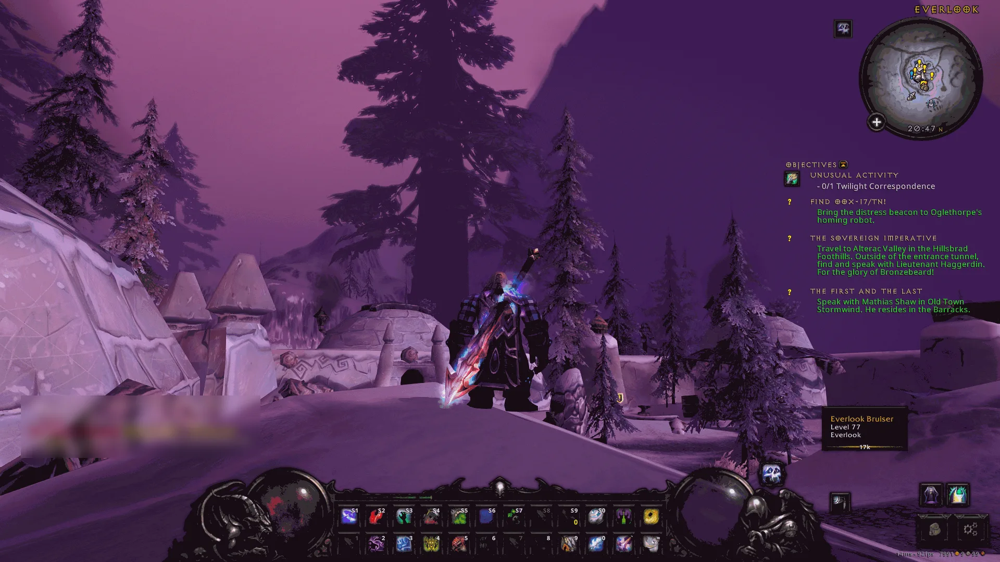

= GShade for DiabolicUI

A darker, Diablo-like look for WoW 3.3.5a: colour grading, a soft blur on the distance and smooth edges, while the UI stays sharp and in its true colours. Everything here was worked out and tested on ChromieCraft under Linux (Proton). On Windows the script should be all you need, but it hasn't been tried there yet.

== 📦 What's in here

[cols="2,3",options="header"]
|===
|File |What for
|`install.py` |sets everything up in your WoW folder (below)
|`files/gshade-addons/ReshadeEffectShaderToggler.addon32` |REST: applies the effects *before* WoW draws its UI, so text and frames are never blurred or tinted
|`files/gshade-addons/ReshadeEffectShaderToggler.ini` |REST's settings, already pointing at WoW's UI shader
|`files/gshade-local-shaders/REST_*.fx` |small helper effects REST needs
|`files/gshade-presets/DiabolicUI/*.ini` |the presets (below)
|===

== 🚀 Install

. Close the game.
. From this folder, run `python3 install.py` (on Windows: `py install.py`). It finds your WoW folder on its own when DiabolicUI is in `Interface/AddOns`; otherwise give it the folder: `python3 install.py /path/to/wow`.
. *Linux only* (Wine, Proton, Faugus, Lutris):
** Wine must load the game folder's `d3d9.dll`: add `d3d9=n,b` to `WINEDLLOVERRIDES`, or in *winecfg → Libraries* add `d3d9` as *Native then Builtin*. In Faugus, the *Winecfg* button in the game's settings opens it.
** GShade needs Microsoft's `d3dcompiler_47`: `winetricks d3dcompiler_47` (or `protontricks`) in the game's prefix.

What the script does, in the WoW folder:

* downloads the latest https://github.com/Mortalitas/GShade/releases[GShade] and installs `GShade32.dll` as `d3d9.dll`, with its shaders and presets;
* downloads Marty McFly's SMAA and qUINT Lightroom, which GShade's download lacks, into `gshade-local-shaders/`;
* adds REST to `gshade-addons/` and the presets to `gshade-presets/DiabolicUI/`;
* sets `GShade.ini`: the add-on folder, the shader folders, the depth settings WoW needs, *Kino* as the startup preset;
* sets WoW's multisampling to 1x in `WTF/Config.wtf` (GShade can't read depth above that).

Anything it replaces is kept in `GShade-backups/`. It can run again safely: files that are already there are kept unless you add `--force`. Already using GShade? `--skip-gshade` only adds the DiabolicUI part. `--dry-run` shows what would change.

== 🎮 First launch

* The first start compiles the effects and can take a while. Later starts are quick.
* Open GShade's menu, *Add-ons* tab: *Reshade Effect Shader Toggler* and *Generic Depth* are ticked, *Generic Depth II* is not.
* Quick check that REST works: on the *Home* tab, search `mono` and tick *Monochrome*. The world turns grey while the whole UI stays in colour. Untick it.
* Happy with the look? Tick *Performance Mode* at the bottom of the *Home* tab: it renders faster. Untick it to move sliders again.

== 🎨 The presets

[cols="1,3",options="header"]
|===
|Preset |Look
|*Kino* (startup) |a filmic grade, brighter, with Nuke LWP's warm and purple tones, its glow, a light blur and grain
|*Sanctuary Lightroom* |warm highlights, cool shadows, less colour, contrast and grain, over a soft Lightroom grade and glow
|*Sanctuary* |the same grading without Lightroom, the glow and Cross Process: plainer and lighter on performance
|===

All three run Marty's SMAA, LumaSharpen, then LightDoF (autofocus on the middle of the screen, blur on the distance), then the colour effects, grain last. The blur strength is *fLightDoF_Amount* in *LightDoF_Far*'s settings.

== 🔧 Troubleshooting

These are the traps we fell in while setting it up.

*Text blurry, UI tinted or grainy.* REST isn't applying the effects before the UI. In *Add-ons → Reshade Effect Shader Toggler*, the group *World before the UI* must be *Active*. If it's missing, `gshade-addons/ReshadeEffectShaderToggler.ini` wasn't installed: run the script again with `--force`.

*No blur in the distance.* The depth of field needs WoW's depth buffer:

* WoW's multisampling must be *1x* (Video options). At 2x and above GShade gets no depth.
* Use *Generic Depth*, not *Generic Depth II*: in our tests II found no depth at all in WoW 3.3.5.
* In *Generic Depth*, *Copy depth buffer before clear operations* must be unticked: the add-on finds no clear on WoW's main depth buffer, so that copy never happens. It says so under its list ("No clear operations were found").
* `RESHADE_DEPTH_INPUT_IS_REVERSED` must be `0` (*Edit Global Preprocessor Definitions* on the *Home* tab).

*The UI gets graded again after a client update.* The UI shader may have changed. To find it again: in REST, click the group's *Settings* and tick *Active*. In the *Group settings* window, click the first code in the list on the left, then go down the list with the arrow keys while watching the game (with *Monochrome* on it's obvious). The right one leaves the world grey and the whole UI in colour; mark it with *Enter* or a double-click (it turns yellow), click *Done*, then *Save all Toggle Groups*. Today it's `0xf5184194`; the one just before it draws particles (spell glows, torches), which then stay ungraded. In this build the numpad keys from REST's own documentation do nothing: use the list.

*Don't use UIMask.* It's a fixed image of where the UI is: when the UI hides (Immersion, Alt+Z) you see its shape as an ungraded silhouette. REST replaces it.

*"Failed to create group render target!" in GShade.log.* Harmless: REST draws straight onto the image instead.

*Using wow_optimize?* We had "RegisterForSave() is only available to Blizzard scripts" and "DiabolicUI has been blocked from an action" errors with its Lua caches on. We run it with `LuaThisFast=0`, `LuaProtoCache=0` and `LuaBytecodeStore=0` in the `[UI_Lua]` section of `WTF/wow_opt.ini`.

== 📜 Credits

* https://github.com/Mortalitas/GShade[GShade] by Marot Satil, downloaded from its releases.
* ReShade Effect Shader Toggler (MIT, `ReshadeEffectShaderToggler-LICENSE.txt`): Frans Bouma's ShaderToggler, alex's REST, facboy's fork for 32-bit D3D9 games. This build comes from https://github.com/apt-get-update/ReshadeEffectShaderToggler[our fork] of it, which falls back to the back buffer in D3D9 and logs why a target is skipped.
* https://github.com/martymcmodding/iMMERSE[iMMERSE SMAA] and https://github.com/martymcmodding/qUINT[qUINT Lightroom] by Pascal Gilcher (Marty McFly), downloaded from their repositories during install, not included here.
* The Lightroom, Ambient Light and Cross Process values in *Kino* and *Sanctuary Lightroom* come from NukeGP's _Nuke LWP (HGP4)_ preset; Kino's Curves, Technicolor2, Levels and DPX values from GShade's _Ruri-Gameplay_ preset.
