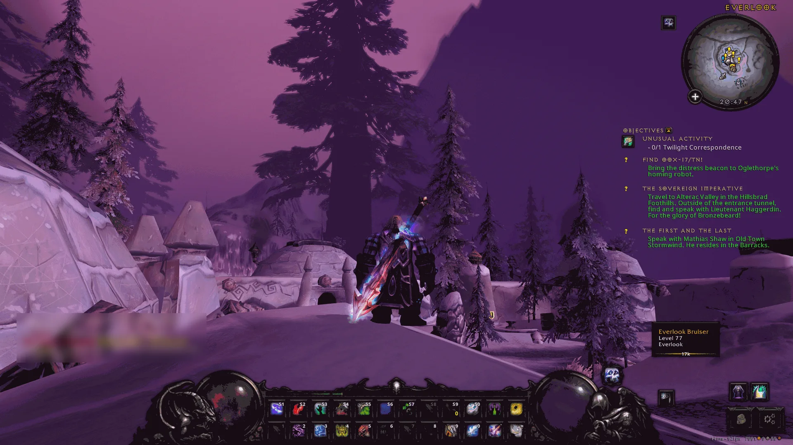

= GShade for DiabolicUI

A darker Diablo look for WoW 3.3.5a: colour grading and a blur on the distance, the UI left sharp. Tested on ChromieCraft under Linux (Proton); not yet tried on Windows.

== Install

. Close the game.
. From this folder: `python3 install.py` (Windows: `py install.py`). If DiabolicUI isn't in your WoW's `Interface/AddOns`, give the WoW folder: `python3 install.py /path/to/wow`.
. *Linux only*: in winecfg → Libraries, set `d3d9` to *Native then Builtin* (or `WINEDLLOVERRIDES=d3d9=n,b`), and run `winetricks d3dcompiler_47` in the game's prefix.
. Start the game. The first start is slow while the effects compile.

The script installs GShade, the shaders it lacks, REST (keeps the effects off the UI) and our presets, and sets WoW's multisampling to 1x. What it replaces goes to `GShade-backups/`. Options: `--force`, `--skip-gshade` (already have GShade), `--dry-run`.

== Presets

* *Kino* (at startup): filmic, brighter, warm and purple tones, light grain.
* *Sanctuary Lightroom*: warm highlights, cool shadows, less colour.
* *Sanctuary*: the same, plainer and lighter on performance.

The blur's strength is *fLightDoF_Amount* in *LightDoF_Far*. Once happy, tick *Performance Mode* (Home tab) for speed.

== Troubleshooting

*UI blurry or tinted.* In *Add-ons → Reshade Effect Shader Toggler*, the group *World before the UI* must be *Active*. Missing? Run the script again with `--force`.

*No blur in the distance.* WoW's multisampling must be *1x*. Use *Generic Depth* (not II), with *Copy depth buffer before clear operations* unticked, and `RESHADE_DEPTH_INPUT_IS_REVERSED` at `0`.

*UI graded again after a client update.* Its shader changed (today `0xf5184194`). In REST's group *Settings*, step through the list with the arrow keys, with *Monochrome* on: pick the one that leaves the UI in colour, mark it with *Enter*, then *Done* and *Save all Toggle Groups*.

*Don't use UIMask*: it leaves the UI's silhouette when the UI hides. REST replaces it.

== Credits

* https://github.com/Mortalitas/GShade[GShade] by Marot Satil, downloaded from its releases.
* ReShade Effect Shader Toggler (MIT, `ReshadeEffectShaderToggler-LICENSE.txt`): Frans Bouma, alex and facboy; built from https://github.com/apt-get-update/ReshadeEffectShaderToggler[our fork].
* https://github.com/martymcmodding/iMMERSE[iMMERSE SMAA] and https://github.com/martymcmodding/qUINT[qUINT Lightroom] by Pascal Gilcher (Marty McFly), downloaded during install, not included.
* Preset values from NukeGP's _Nuke LWP (HGP4)_ and GShade's _Ruri-Gameplay_.
